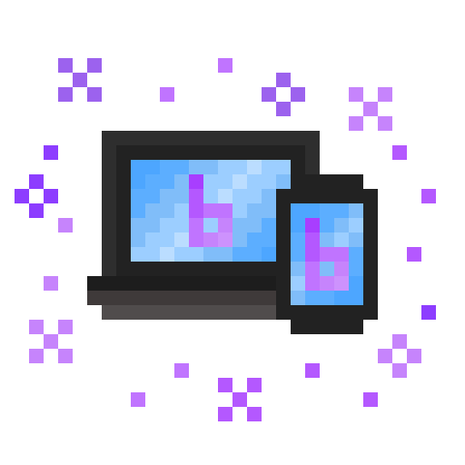

# bedrocklol's cave

This is my personal website's template code; used to showcase my artworks, projects, and more. Available on Neocities and GitHub!

[Template Page](https://bedrocklols-cave.github.io/bedrocklolscave/)

## Features

- Pastel Purple theme with light/dark modes based on your browser settings.
- Responsive mobile layout!
- Little to no JavaScript, add your own code!
- Built-in gallery and project wrapper by assigning divs with .gallery and .project class.
- My own handmade background, complete with dark mode version!
- High extensibility.